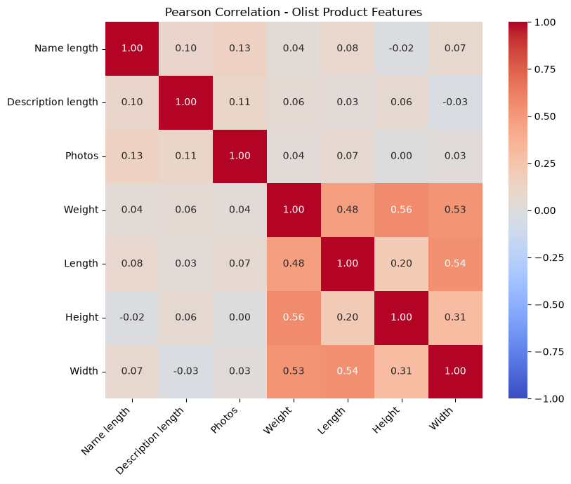

# ML2 - Labwork 1: Principle component analysis

*16 November - 22 November 2026*

| Name | Student ID |
|---|---|
| Tran Mai Anh | 2410093 |
| Nguyen Van Khanh | 2410460 |

## I. Study the dataset
### 1. Dataset 1: Brazilian E-Commerce Public Dataset by Olist
### 1.1. Overview and Description
- Data source: [Olist Products](https://www.kaggle.com/datasets/olistbr/brazilian-ecommerce?select=olist_products_dataset.csv)
- The dataset contains 32951 product records and 9 columns, including 7 numerical attributes, 1 categorical attribute and 1 product identifier

| **Feature** | **Brief Description** | **Feature Type** |
|---|---|---|
| `product_id` `product_category_name` | Unique product identifier   Original product category in Portuguese | Qualitative, Categorical |
| `product_name_lenght`  `product_description_lenght`  `product_photos_qty` | Number of characters in the product name   Number of characters in the product description   Number of published product photos | Quantitative, Numerical, Discrete |
| `product_weight_g`  `product_length_cm`  `product_height_cm`  `product_width_cm` | Product weight measured in grams   Product length measured in centimeters   Product height measured in centimeters   Product width measured in centimeters | Quantitative, Numerical, Continuous |

- The feature `product_category_name` attribute in this dataset can be used as a target variable for a multi-class classification, where product categories are predicted using other product attributes. When working on this problem, the `product_id` will not be used as the input feature.

### 1.2. Data Cleaning

By applying different data cleaning operations, here is the result of this process:

| | Before | After |
|---|---|---|
| **Total records** | 32951 | 32336 |
| **Missing numerical value records** | 611 | 0 |
| **Zero weight value records** | 4 | 0 |
| **Duplicate records** | 0 | 0 |
| **Records with detected inconsistencies** | 0 | 0 |

- A total of 615 records (1.87% of the original dataset) were removed, including 611 records with at least one missing numerical value anf 4 records with zero product weight. The record removal instead of adding missing values generally can preserve the data integrity, avoid artificial values that could affect variance and correlation, maintain the statistical reliability. Moreover, the removed instances is not too much and the remaining data is still enough for the data analysis and data visualization.

- As usual, the duplicate records can repeat the observations, leading to the problem of data distribution. In this dataset, it is detected that there is no duplicate records, so the duplicate removal was unnecessary.

- No inconsistencies were detected during the consistency checks; therefore, no additional corrections were required. 

- Outlier detection: IQR method is applied in this stage. It is a non-parametric, distribution-agnostic technique used to identify anomalies or extreme values in a dataset. The IQR method is expressed as:  
                            $$IQR = Q_3 - Q_1$$
where $Q_1$ (The first quartile) is denoted as the median of the lower half of the data and $Q_3$ (The third quartile) is the median of the upper half of the data. The data point (denoted as $x$) is flagged as an outlier is displayed as:
$$
x < Q_1 - 1.5IQR
\quad \text{or} \quad
x > Q_3 + 1.5IQR
$$
The outliers are not necessarily incorrect values. In outlier handling, the IQR method can detect statistically abnormal values instead of determine whether extreme values are wrong. Retaining outliers can preserve the natural variability because removing all the outliers may lead to the loss of valid extreme observations. Furthermore, keeping the outliers can avoid unnecessary information loss as extreme observations may be useful for the dataset. In contrast, IQR also has some limitations. The outliers may increase the variance, affecting the covariance and correlation and also the directions of principal components in PCA later on. The result of applying IQR in this dataset

- IQR outlier detection in Olis Product dataset is applied for all 7 numerical features. Here is the result table:

| Feature | Flagged outliers | Percentage (%) |
|---|---|---|
| `product_name_lenght` | 290 | 0.90 |
| `product_description_lenght` | 2078 | 6.43 |
| `product_photos_qty` | 849 | 2.63 |
| `product_weight_g` | 4551 | 13.81 |
| `product_length_cm`| 1380 | 4.19 |
| `product_height_cm` | 1892 | 5.74 |
| `product_width_cm` | 912 | 2.77 |

From the above result, the `product_weight_g` has the highest proportion of flagged outliers (13.81%), meaning that the weight of the product is significantly variable and has many values outside the IQR range. In contrast, the `product_name_lenght` accounts for the lowest outliers percentage (0.9%), indicating that the number of extreme values according to IQR rules is relatively small. In general, numerical features may vary across product categories, so it should not automatically be considered that outliers are erroneous values.

### 1.3. Data Integration and Transformation
#### 1.3.1. Data Integration

The original Olist Products dataset contains `product_category_name` in Portuguese, which made the category names difficult to understand. However, the dataset includes another file `product_category_name_translation.csv`. It contains the corresponding English category names to improve the readability and interpretability. Both files are matched using `product_category_name` feature, so it is the matching key. Therefore, the `product_category_name_english` feature in this dataset was merged into the current `olist_products_dataset.csv` to allow easier category-based analysis and visualization.

The left merge method was performed using `product_category_name` as the matching key to preserve all the records in the Olist Products dataset. The merged result is displayed as the table below:

| | Result |
|---|---|
| Rows before integration | 32336 |
| Rows after integration | 32336 |
| Duplicate category keys | 0 |
| Products without English translation | 13 |
| Missing display labels | 0 |

The result showed that the number of records remained unchanged, indicating that the integration process did not lose or duplicate records. However, after the left merge, there were 13 products without English translation: 10 products belonging to the category `portateis_cozinha_e_preparadores_de_alimentos` and the other 3 belonging to the `pc_gamer` category. To preserve the records and avoid missing display labels, it was decided to apply the fallback-to-original-category method, which means that the dataset used the original Portuguese category name for these products instead of removing them. This ensures that every product has a category label for subsequent analysis and visualization.

The following table presents five examples of category mappings after integration.

| `product_category_name` | `product_category_name_english` |
|---|---|
| beleza_saude | health_beauty |
| informatica_acessorios | computers_accessories |
| automotivo | auto |
| cama_mesa_banho | bed_bath|table |
| moveis_decoracao | furniture_decor |

#### 1.3.2. Data Transformation

- 7 numerical features were used for tranformation, except `product_id` worked as the identifier and the `product_category_name` worked as the categorical feature.
- Standardization method: Z-score standarization, the results is shown below:

Table: Numerical Feature Statistics Before and After Standardization

| Feature | Mean Before | Std Before | Mean After | Std After |
|---|---|---|---|---|
| `product_name_lenght` | 48.4762 | 10.2461 | -0.0 | 1.0 |
| `product_description_lenght` | 771.5525 | 635.1485 | 0.0 | 1.0 |
| `product_photos_qty` | 2.1891 | 1.7368 | 0.0 | 1.0 |
| `product_weight_g` | 2277.2382 | 4279.4154 | 0.0 | 1.0 |
| `product_length_cm` | 30.8547 | 16.9567 | -0.0 | 1.0 |
| `product_height_cm` | 16.9578 | 13.6365 | 0.0 | 1.0 |
| `product_width_cm` | 23.2078 | 12.0791 | 0.0 | 1.0 |

Since the numerical features have different units (grams, centimeters, number of photos), Z-score standardization was applied to rescale features so that their means and standard deviations are approximately 0 and 1, respectively. This step allows PCA to analyze the variance without being dominated by the units of measurement.

However, the standardization still contains outliers because the mean and standard deviation still rely on extreme observations. Therefore, these outliers may still affect the PCA results later on.

### 1.4. Data Visualization
#### 1.4.1. Mean, Variance
The mean and variance results are displayed in the table below:

| Feature | Mean | Variance | 
|---|---|---|
| `product_name_lenght` | 48.4762 | 1.049859e+02 |
| `product_description_lenght` | 771.5525 | 4.034261e+05 |
| `product_photos_qty` | 2.1891 | 3.016600e+00 |
| `product_weight_g` | 2277.2382 | 1.831396e+07	 |
| `product_length_cm` | 30.8547 | 2.875402e+02	 |
| `product_height_cm` | 16.9578 | 1.859586e+02 |
| `product_width_cm` | 23.2078 | 1.459088e+02 |

#### 1.4.2. Categorical Statistics
The Olist Products dataset contains 73 categories, so Frequency count and its proportion is applied to calculate the number of products belong to each category. Here are the results of top 5 most frequent categories (in English translation) and their percentage:

| `product_category_name_english` | Frequency | Percentage (%) |
|---|---|---|
| bed_bath_table | 3025 | 9.35 |
| sports_leisure | 2867 | 8.87 |
| furniture_decor | 2657 | 8.22 |
| health_beauty | 2444 | 7.56 |
| housewares | 2335 | 7.22 |

#### 1.4.3. Correlation Analysis

By Pearson correlation calculation methods among 7 numerical features in the cleaned Olist Products dataset, we have found that the strongest correlation pair is Weight - Height with $r = 0.5626$, indicating a moderate positive linear relationship, suggesting that taller products tend to be heavier. In addition, there are also other moderate positive relationship, such as Length - Width ($r = 0.5417$), Weight - Width ($r = 0.5268$), and Weight - Length ($r = 0.4762$). In contrast, features like name length, description length and photos show weak linear relationships with physical features. When applying in PCA later, correlated physical features share some information that PCA may capture their common variation in fewer components.