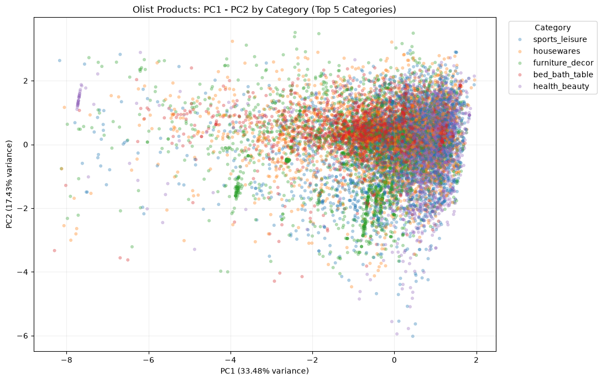

# ML2 - Labwork 1: Principle component analysis

*16 November - 22 November 2026*

| Name | Student ID |
|---|---|
| Tran Mai Anh | 2410093 |
| Nguyen Van Khanh | 2410460 |

## I. Study the dataset
### 1. Dataset 1: Brazilian E-Commerce Public Dataset by Olist
### 1.1. Overview and Description
- Data source: [Olist Products](https://www.kaggle.com/datasets/olistbr/brazilian-ecommerce?select=olist_products_dataset.csv)
- The dataset contains 32951 product records and 9 columns, including 7 numerical attributes, 1 categorical attribute and 1 product identifier

| **Feature** | **Brief Description** | **Feature Type** |
|---|---|---|
| `product_id` `product_category_name` | Unique product identifier   Original product category in Portuguese | Qualitative, Categorical |
| `product_name_lenght`  `product_description_lenght`  `product_photos_qty` | Number of characters in the product name   Number of characters in the product description   Number of published product photos | Quantitative, Numerical, Discrete |
| `product_weight_g`  `product_length_cm`  `product_height_cm`  `product_width_cm` | Product weight measured in grams   Product length measured in centimeters   Product height measured in centimeters   Product width measured in centimeters | Quantitative, Numerical, Continuous |

- The `product_category_name` attribute in this dataset can be used as a target variable for a multi-class classification, where product categories are predicted using other product attributes. When working on this problem, the `product_id` will not be used as the input feature.

### 1.2. Data Cleaning
#### 1.2.1. Missing values, duplicate records, inconsistencies
By applying different data cleaning operations, here is the result of this process:

| | Before | After |
|---|---|---|
| Total records | 32951 | 32336 |
| Missing numerical value records | 611 | 0 |
| Zero weight value records | 4 | 0 |
| Duplicate records | 0 | 0 |
| Records with detected inconsistencies | 0 | 0 |
| **Total number of removed records** | **615** |

Four zero-weight values were denoted as missing, so a total of 615 rows were removed, accounting for 1.87% of the original dataset. After the data cleaning process, there were 32336 products left with complete numerical features.

Removing the missing records can help improve PCA input quality. However, if the missing data are not random, this may introduce bias.

#### 1.2.2. Outlier detection
IQR method was applied in this stage. It is a non-parametric, distribution-agnostic technique used to identify anomalies or extreme values in a dataset. The IQR method is expressed as:  
                            $$IQR = Q_3 - Q_1$$
where $Q_1$ (The first quartile) is denoted as the median of the lower half of the data and $Q_3$ (The third quartile) is the median of the upper half of the data. A data point (denoted as $x$) is flagged as an outlier if:
$$
x < Q_1 - 1.5IQR
\quad \text{or} \quad
x > Q_3 + 1.5IQR
$$
The outliers are not necessarily incorrect values. In outlier handling, the IQR method can detect statistically abnormal values instead of determining whether extreme values are wrong. Retaining outliers can preserve the natural variability because removing all the outliers may lead to the loss of valid extreme observations. Furthermore, keeping the outliers can avoid unnecessary information loss as extreme observations may be useful for the dataset. In contrast, IQR also has some limitations. The outliers may increase the variance, affecting the covariance and correlation and also the directions of principal components in PCA.

IQR outlier detection was applied to all 7 numerical features in the original Olist Products dataset. Here is the result table:

| Feature | Flagged outliers | Percentage (%) |
|---|---|---|
| `product_name_lenght` | 290 | 0.90 |
| `product_description_lenght` | 2078 | 6.43 |
| `product_photos_qty` | 849 | 2.63 |
| `product_weight_g` | 4551 | 13.81 |
| `product_length_cm`| 1380 | 4.19 |
| `product_height_cm` | 1892 | 5.74 |
| `product_width_cm` | 912 | 2.77 |

From the above result, the `product_weight_g` has the highest proportion of flagged outliers (13.81%), meaning that the weight of the product is significantly variable and has many values outside the IQR range. In contrast, the `product_name_lenght` accounts for the lowest outlier percentage (0.9%), indicating that the number of extreme values according to IQR rules is relatively small. In general, numerical features may vary across product categories, so it should not automatically be considered that outliers are erroneous values.

### 1.3. Data Integration and Transformation
#### 1.3.1. Data Integration

The original Olist Products dataset contains `product_category_name` in Portuguese, which may be difficult to understand. However, the dataset includes another file `product_category_name_translation.csv`. It contains the corresponding English category names to improve the readability and interpretability. Both files were matched using `product_category_name` as the matching key. Therefore, the `product_category_name_english` feature in this dataset was merged into the current `olist_products_dataset.csv` to allow easier category-based analysis and visualization.

The left merge method was performed using `product_category_name` as the matching key to preserve all the records in the Olist Products dataset. The merged result is displayed as the table below:

| | Result |
|---|---|
| Rows before integration | 32336 |
| Rows after integration | 32336 |
| Duplicate category keys | 0 |
| Products without English translation | 13 |
| Missing display labels | 0 |

The result showed that the number of records remained unchanged, indicating that the integration process did not lose or duplicate records. However, after the left merge, there were 13 products without English translation. To preserve the records and avoid missing display labels, it was decided to apply the fallback-to-original-category method, which means that the dataset used the original Portuguese category name for these products instead of removing them. This ensures that every product has a category label for subsequent analysis and visualization.

The following table presents five examples of category mappings after integration, including the category without an English translation:

| `product_category_name` | `category_display` |
|---|---|
| beleza_saude | health_beauty |
| informatica_acessorios | computers_accessories |
| automotivo | auto |
| cama_mesa_banho | bed_bath_table |
| pc_gamer | pc_gamer |

#### 1.3.2. Data Transformation

- Seven numerical features were used for transformation, while `product_id` and `product_category_name` were excluded as the identifier and categorical feature, respectively.
- Standardization method: Z-score standardization, the results are shown below:

Table: Numerical Feature Statistics Before and After Standardization

| Feature | Mean Before | Std Before | Mean After | Std After |
|---|---|---|---|---|
| `product_name_lenght` | 48.4762 | 10.2461 | -0.0 | 1.0 |
| `product_description_lenght` | 771.5225 | 635.1485 | 0.0 | 1.0 |
| `product_photos_qty` | 2.1891 | 1.7368 | 0.0 | 1.0 |
| `product_weight_g` | 2277.2382 | 4279.4154 | 0.0 | 1.0 |
| `product_length_cm` | 30.8547 | 16.9567 | -0.0 | 1.0 |
| `product_height_cm` | 16.9578 | 13.6365 | 0.0 | 1.0 |
| `product_width_cm` | 23.2078 | 12.0791 | 0.0 | 1.0 |

Since the numerical features have different units (grams, centimeters, number of photos), Z-score standardization was applied to rescale features so that their means and standard deviations are approximately 0 and 1, respectively. This step allows PCA to analyze the variance without being dominated by the units of measurement.

However, the standardization still contains outliers because the mean and standard deviation still rely on extreme observations. Therefore, these outliers may still affect the PCA results.

### 1.4. Data Visualization
#### 1.4.1. Mean, Variance
The mean and variance results are displayed in the table below:

| Feature | Mean | Variance | 
|---|---|---|
| `product_name_lenght` | 48.4762 | 1.049859e+02 |
| `product_description_lenght` | 771.5225 | 4.034261e+05 |
| `product_photos_qty` | 2.1891 | 3.016600e+00 |
| `product_weight_g` | 2277.2382 | 1.831396e+07	 |
| `product_length_cm` | 30.8547 | 2.875402e+02	 |
| `product_height_cm` | 16.9578 | 1.859586e+02 |
| `product_width_cm` | 23.2078 | 1.459088e+02 |

#### 1.4.2. Categorical Statistics
The Olist Products dataset contains 73 categories, so frequency count and proportions were calculated for each category. Here are the results of top 5 most frequent categories (in English translation) and their percentage:

| `product_category_name_english` | Frequency | Percentage (%) |
|---|---|---|
| bed_bath_table | 3025 | 9.35 |
| sports_leisure | 2867 | 8.87 |
| furniture_decor | 2657 | 8.22 |
| health_beauty | 2444 | 7.56 |
| housewares | 2335 | 7.22 |

#### 1.4.3. Correlation Analysis

By Pearson correlation calculation methods among 7 numerical features in the cleaned Olist Products dataset, we found that the strongest correlation pair is Weight - Height with $r = 0.5626$, indicating a moderate positive linear relationship, suggesting that taller products tend to be heavier. In addition, there are also other moderate positive relationships, such as Length - Width ($r = 0.5417$), Weight - Width ($r = 0.5268$), and Weight - Length ($r = 0.4762$). In contrast, features like name length, description length and photos show weak linear relationships with physical features. When applying in PCA later, correlated physical features share some information that PCA may capture their common variation in fewer components.

### 1.5. Principal Component Analysis (PCA)
#### 1.5.1. Preprocessing data
- PCA input shape: (32336, 7)
- Missing values: 0 (data was cleaned in the Study process)
- The covariance matrix has shape (7, 7) and was computed from the standardized data to examine how the numerical features vary together.

#### 1.5.2. Explained variance of each PC
Eigenvectors define the principal component (PC) directions, while eigenvalues represent the variance along these directions. The PCs are sorted by eigenvalues in the descending order. The eigenvalue results, the corresponding explained variance (measured in %) and the cumulative variance were computed as follows:

| Component | Eigenvalue | Explained variance (%) | Cumulative variance (%) |
|---|---|---|---|
| PC1 | 2.3434 | 33.4761 | 33.4761 |
| PC2 | 1.2201 | 17.4288 | 50.9049 |
| PC3 | 0.9786 | 13.9797 | 64.8846 |
| PC4 | 0.8658 | 12.3678 | 77.2523 |
| PC5 | 0.7997 | 11.4244 | 88.6767 |
| PC6 | 0.4408 | 6.2972 | 94.9739 |
| PC7 | 0.3518 | 5.0261 | 100.00 |

The result shows that PC1 has the highest explained variance ($33.48\%$), while PC7 is the lowest ($5.03\%$). The objective of PCA is to reduce the dimensions while preserving as much variance as possible. Here, PCs with high explained variance tend to be selected when aiming to lower the dimensionality. Therefore, principal components with higher explained variance are generally prioritized for dimensionality reduction, while those with lower explained variance may be discarded with relatively less information loss.

#### 1.5.3. The number of selected PCs
Since the number of selected PCs increases, corresponding to an increase in retained variance, the number of dimensions removed decreases. As the following table clarifies:

| Number of PCs selected | Retained variance (%) | Discarded variance (%) | Dimensions removed |
|---|---|---|---|
| 1 | 33.48 | 66.52 | 6 |
| 2 | 50.90 | 49.10 | 5 |
| 3 | 64.88 | 35.12 | 4 |
| 4 | 77.25 | 22.75 | 3 |
| 5 | 88.68 | 11.32 | 2 |
| 6 | 94.97 | 5.03 | 1 |
| 7 | 100.00 | 0.00 | 0 |

#### 1.5.4. Data distribution visualization in 2D using PC1 and PC2

The diagram illustrates the category distribution in 2D using PC1 and PC2, as described in Part 1.1 that `product_category_name` was used as the label. However, the dataset contains 73 categories, so we decided to select only 5 most frequent product categories to visualize. 

As observed, most observations are concentrated in a high-density region near the center-right of the plot. The categories overlap considerably, so they are not clearly separated. Another limitation is PC1 and PC2 together explain only 50.9% of the total variance; therefore, the remaining 49.1% of variance is not represented in the 2D projection.

#### 1.5.5. Original - PCA representation and PCA's pros and cons
 
| | Original numerical data | PCA representation |
|---|---|---|
| Overall | Each product is described by 7 numerical features | Each product is described by ${k}$ principal component scores   Each PC is a linear combination of the 7 standardized features |
| Dimensions | 7  | ${k}$, with ${k}$ = 2 used for visualization |
| No. of products | 32336 | 32336 (unchanged) |

**PCA pros and cons based on information preservation, interpretability, visualization**

| Aspect | Advantages | Limitations |
|---|---|---|
| **Information preservation** | PCA selects directions that retain the greatest variance for a given number of components. In this dataset, 5 PCs retain 88.68% of the total variance, while 6 PCs retain 94.97%. | Reducing dimensionality discards some variance. The first two PCs retain only 50.90%, leaving 49.10% unrepresented in the 2D projection. |
| **Interpretability** | Examining the component coefficients helps identify which original features contribute most to each PC. For example, PC1 mainly reflects variation in product weight and physical dimensions. | PCs combine multiple standardized features, making them less directly interpretable than original measurements such as weight in grams or height in centimetres. |
| **Visualization** | Projecting onto PC1 and PC2 allows the seven-dimensional data to be explored in a 2D scatter plot, showing concentrations, overlaps, and isolated points. | The plot captures only part of the total variance. The five displayed product categories overlap considerably, so they are not clearly separated in this projection. |